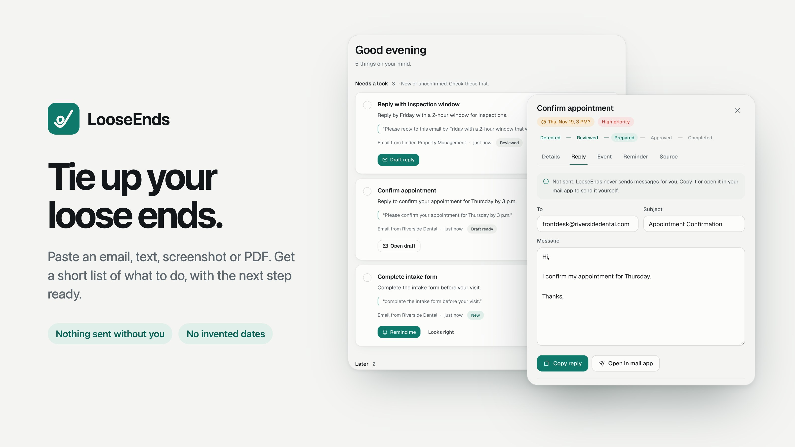
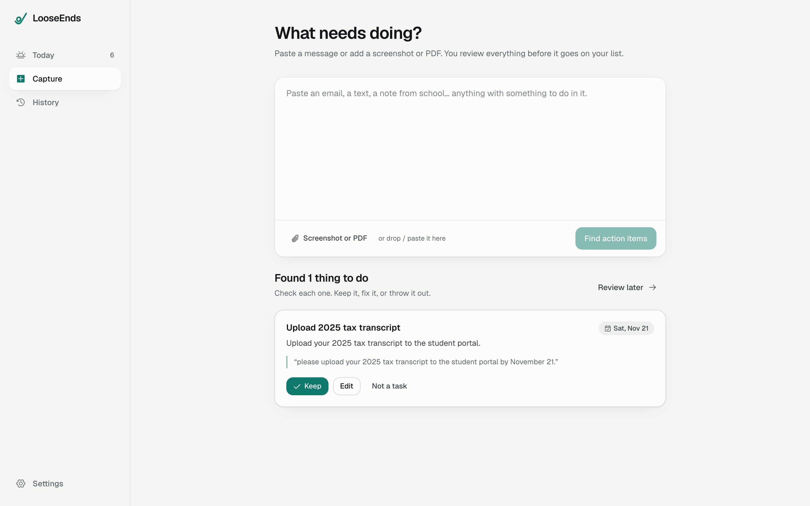
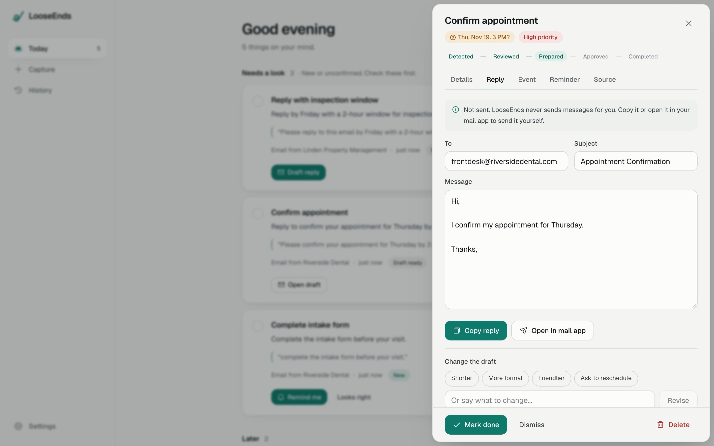
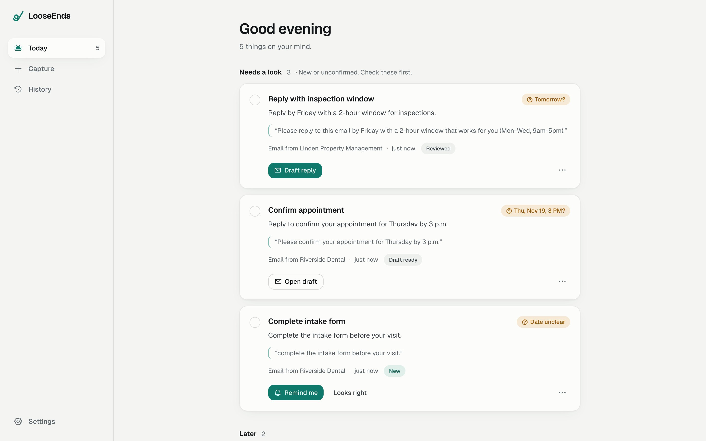
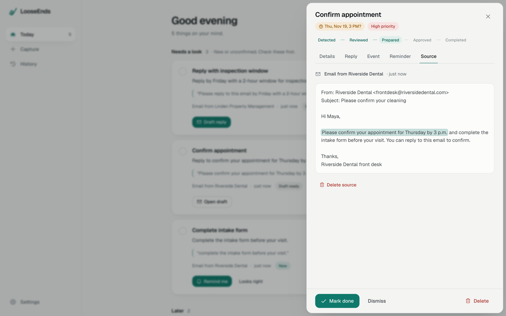
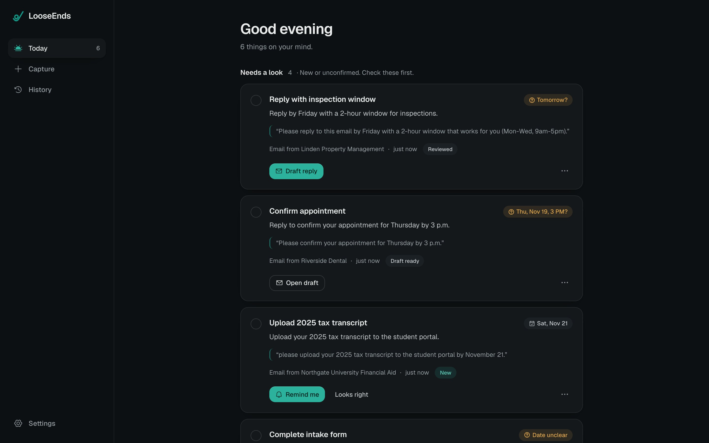
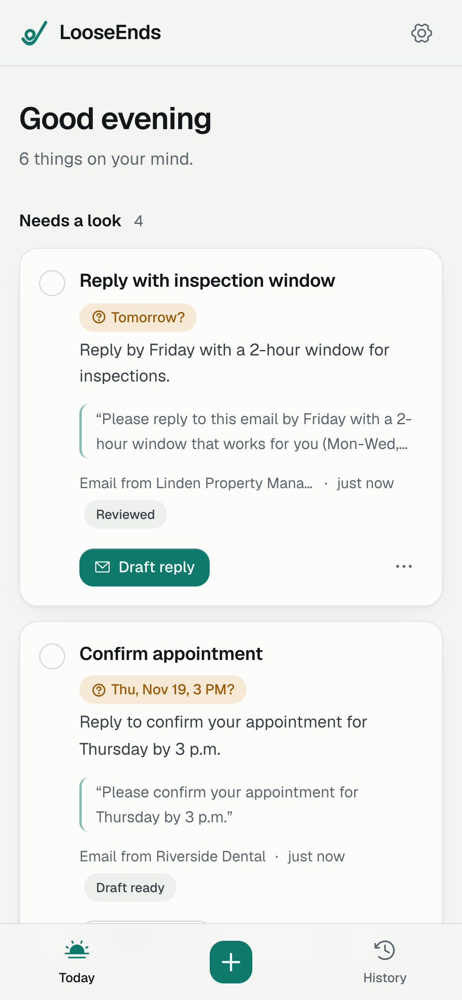

# LooseEnds

**The assistant for the everyday admin that slips through the cracks.**

Paste an email, a text, a screenshot or a PDF. LooseEnds finds what you actually have to do, shows you the exact sentence it came from, and gets the next step ready: a reply to send, an event for your calendar, or a reminder. You stay in control. LooseEnds never sends, books, pays or deletes anything on its own.

It's built for the small stuff that piles up:

- **Students**: registrations, forms, advisor emails, financial aid and scholarship deadlines.
- **Young professionals**: scheduling back-and-forth, renewals, service follow-ups.
- **Everyone else**: appointments, returns, bills, bookings, the letter on the counter.

Sign in with publik and drop in your first message. You can connect apps such as Gmail and Google Calendar when you want them.

## How it works

### 1. Drop it in
Paste a message, attach a screenshot or a PDF, or drag it onto the box. If you don't have one handy, tap an example.

### 2. Check what it found
Each task has a plain title ("Confirm appointment"), the next step, its due date, and the quote it came from. Keep it, fix it, or throw it out.

### 3. Get the next step ready
- **Draft a reply.** It writes a short reply using only what's in the message. Copy it, or open it in your mail app and send it yourself. If the reply needs something only you know, like which time slot works for you, it leaves a clear [blank] instead of guessing.
- **Prepare a calendar event.** Download an `.ics` file or open it in Google Calendar.
- **Set a reminder.** It shows up in LooseEnds when it's due, with a browser notification if you allow it.

### 4. Come back tomorrow
Your list is waiting: what needs a look, what's overdue, what's due this week. Finished and dismissed items move to History, along with a receipt of everything you copied, opened or downloaded.

## Built to be trusted

- **Every task shows its source.** Tap the quote to see the original message with the exact sentence highlighted.
- **No invented dates.** "December 3, 2026" is taken as written. "Thursday by 3 p.m." is worked out and shown with a question mark until you confirm it. "Before your visit" is marked *Date unclear*. If a message gives no date, there isn't one.
- **You approve external actions.** LooseEnds drafts replies and previews connected-app actions before you confirm them.
- **Messages are data, not commands.** If an email tries to give the AI instructions ("ignore previous instructions and…"), LooseEnds flags it and ignores it.
- **Duplicates are caught.** Paste the same message twice and it tells you, instead of doubling your list. Similar tasks get a "Merge" suggestion.
- **Marketing is filtered.** Newsletters and sales emails are recognised as promotions, not obligations.
- **You control your data.** Your list is stored in LooseEnds' database, with keys encrypted. Delete a task, a message, or everything from Settings.

## Light, dark and phone-sized

LooseEnds follows your system theme and works at any window size.

  
  

## AI and pricing

LooseEnds uses **publik API**, so there's no key to paste: sign in with publik, connect your plan, and you're set. Linking your publik account gives $0.05 of free use once (about five AI requests at publik's published price of about $0.01 each); after that, a publik plan pays per use. Prefer your own key? Choose **Use my own key** at sign-in or in Settings; any OpenAI-compatible provider works.

Your content is sent to the AI model only to find tasks and write drafts. publik does not train on requests.

## Open LooseEnds

Open [LooseEnds](https://looseends-taupe.vercel.app) in your browser or use **Get started** on [publik](https://publikhq.com/looseends). Sign in with publik to begin.

## For developers

Next.js 16 (App Router), Tailwind CSS v4, Motion, Neon Postgres (PGlite for local development) and publik API (`publik-balanced`). Hosted configuration uses `DATABASE_URL`, `APP_SECRET`, `COMPOSIO_API_KEY`, and `PUBLIK_APP_TOKEN`; see `.env.example`.

- `src/lib/server/publik.ts`: Sign in with publik, usage counting and publik API (adapted from publik's reference module).
- `src/lib/server/extract.ts`: task extraction and the server-side date and evidence rules.
- `src/components/app/`: the app UI.
- `scripts/mock-publik.mjs`: a local stand-in for publik, for testing without an account. Run it, then start the app with `PUBLIK_ORIGIN=http://localhost:4555 PUBLIK_APP_TOKEN=pat_mocktoken`.

`PUBLIK_SELF_TEST=1 pnpm start` prints `publik self-test: ok looseends <version>` once publik answers.

## License

MIT
