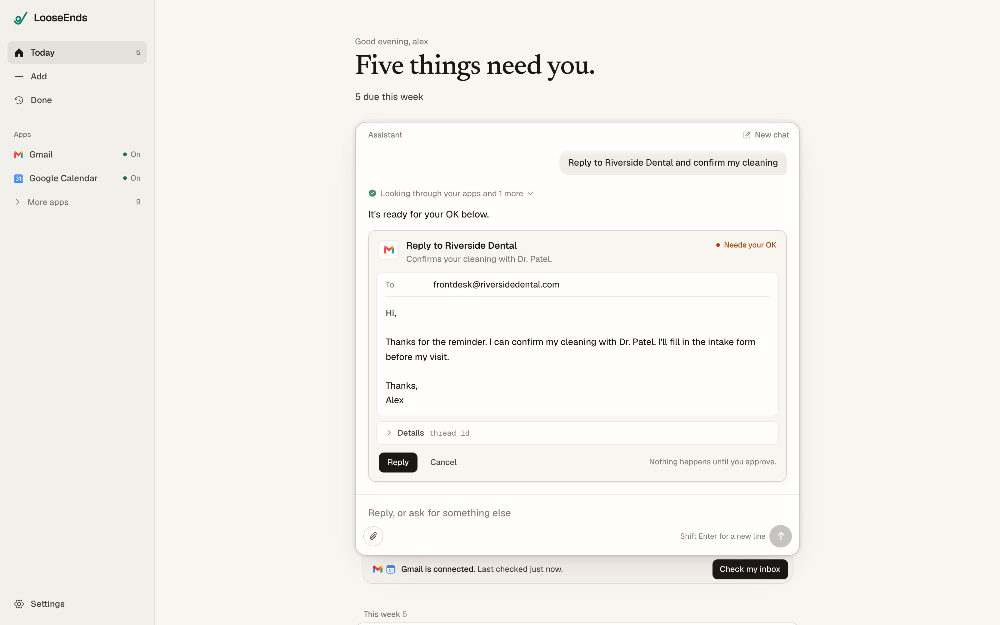
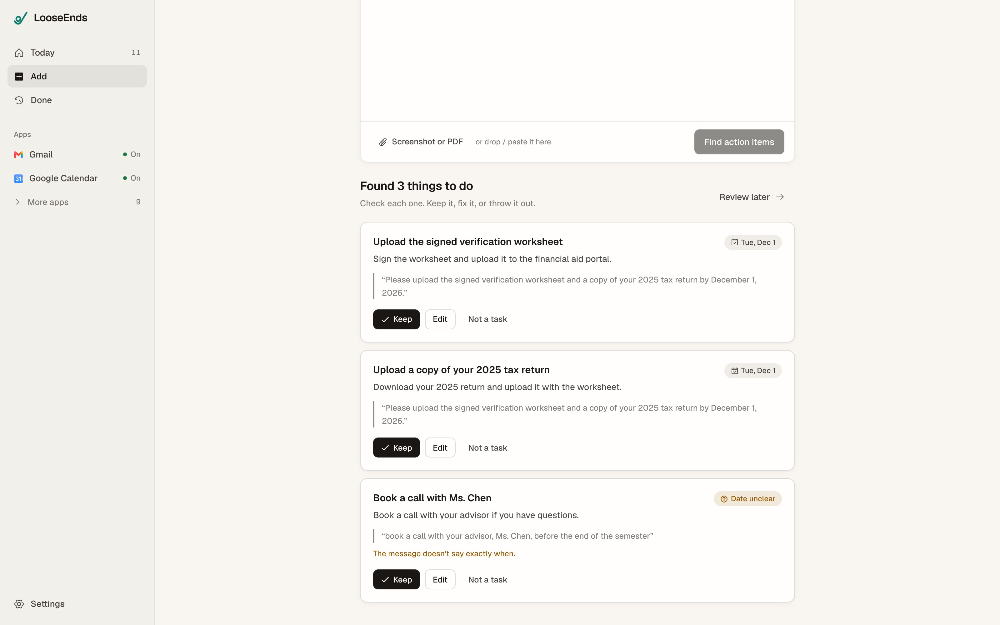
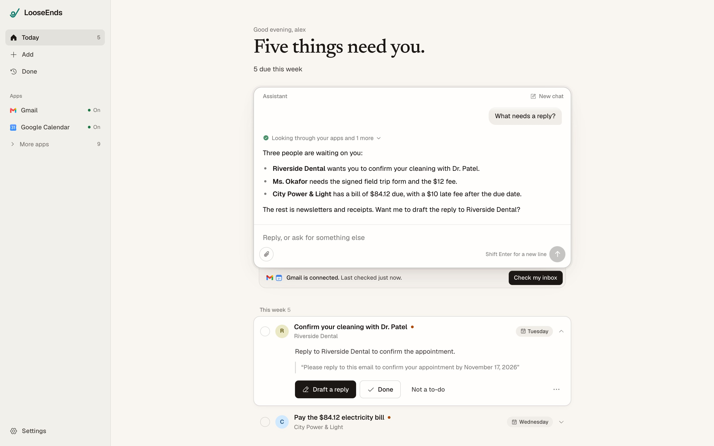
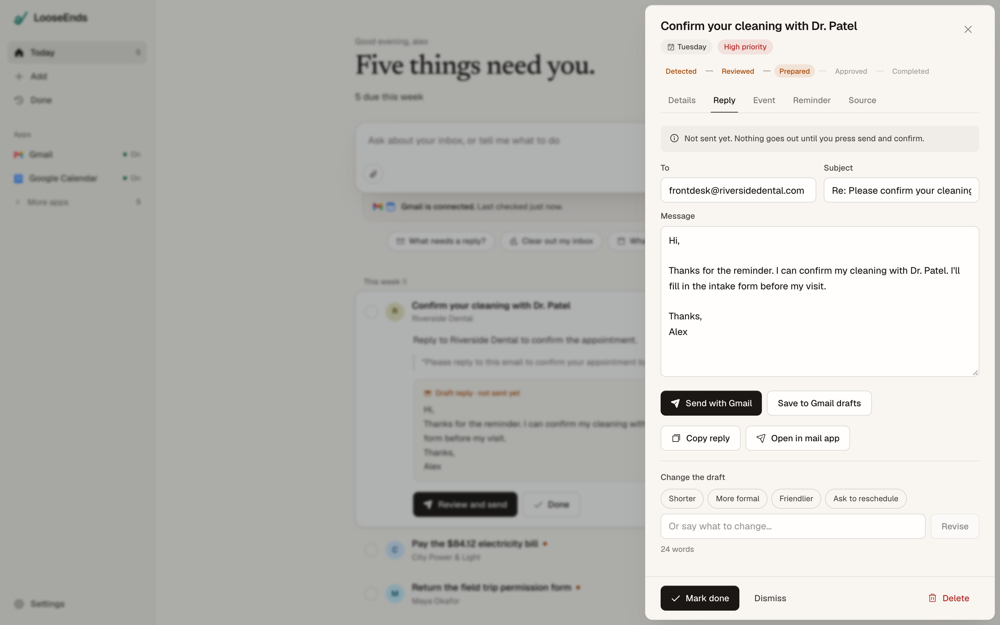
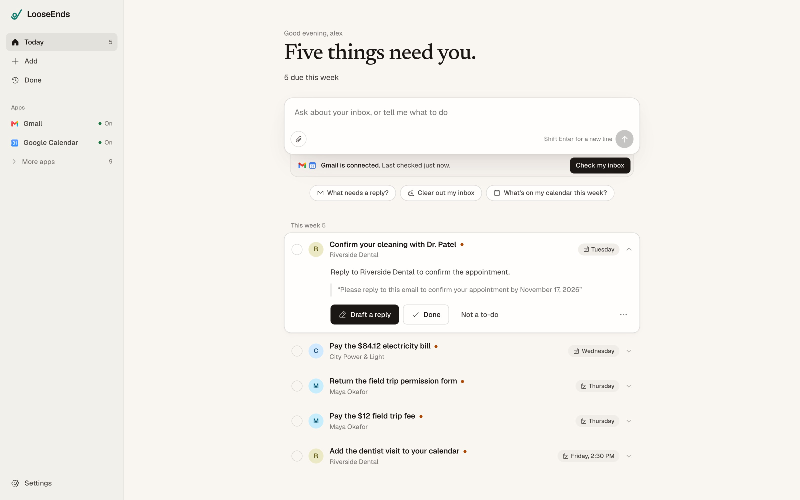
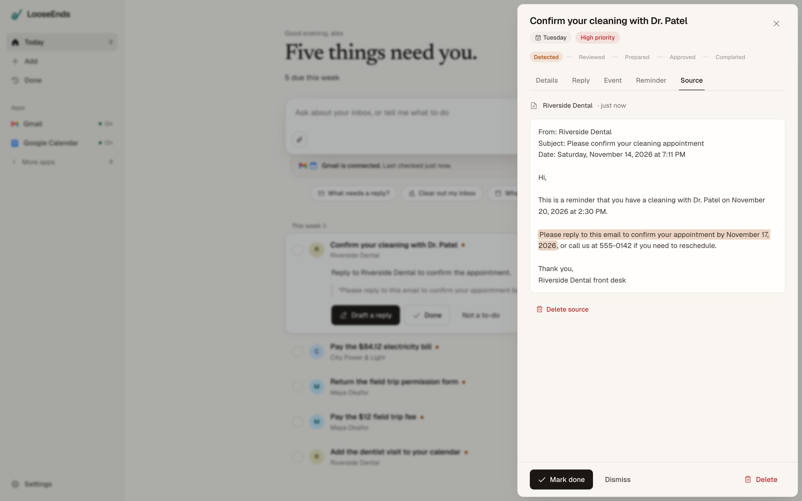

# LooseEnds

**The assistant for the everyday admin that slips through the cracks.**

Connect Gmail and ask in plain words, or drop in a screenshot or a PDF. LooseEnds works across your inbox, calendar and other apps, finds what you actually have to do, shows you the exact sentence it came from, and gets the next step ready: a reply, a calendar event, a reminder, or an action in one of your apps. Nothing is sent, posted, changed or deleted until you approve it.

It's built for the small stuff that piles up:

- **Students**: registrations, forms, advisor emails, financial aid and scholarship deadlines.
- **Young professionals**: scheduling back-and-forth, renewals, service follow-ups.
- **Everyone else**: appointments, returns, bills, bookings, the letter on the counter.

## How it works

### 1. Drop it in, or ask
Paste a message, attach a screenshot, a phone photo or a PDF, or connect Gmail and ask LooseEnds to check your inbox. Each task has a plain title, the next step, its due date, and the quote it came from. Keep it, fix it, or throw it out.



### 2. Ask the assistant
Type what you want in plain words: "What needs a reply?", "Clear out my inbox", "What's on my calendar this week?", "Reply to Riverside and confirm Thursday". The assistant reads your tasks and the apps you connected, answers, and adds or completes tasks.



### 3. Approve what goes out
When something would change the outside world (send an email, post a message, add an event, create or delete something in an app), the assistant puts an approval card in front of you instead. The card shows the readable parts to check and edit (To, Subject, the message) and, under **Details**, every other value that will be sent: ids, links, numbers and nested data. Nothing happens until you press the button. You can also cancel.

Every reply task also has **Draft a reply**: a short draft written only from the message, which you can send with Gmail, save to drafts, copy, or change.



### 4. Come back tomorrow
Your list is waiting: what needs you now, what's coming later. Finished and dismissed items move to Done, with a receipt of what you sent, copied or downloaded.



## Connected apps

Connecting apps is optional. LooseEnds can connect **Gmail, Google Calendar, Outlook, Slack, Notion, Google Drive, Google Docs, Google Sheets, GitHub, Linear and Todoist**. Connections are made and held by [Composio](https://composio.dev); you can disconnect any app in Settings.

## Built to be trusted

- **Every task shows its source.** Tap the quote to see the original message with the exact sentence highlighted.
- **No invented dates.** "December 3, 2026" is taken as written. "Thursday by 3 p.m." is worked out and shown with a question mark until you confirm it. "Before your visit" is marked *Date unclear*.
- **You approve external actions, and see all of them.** Approval cards show every argument the action sends, not just the friendly summary.
- **Messages are data.** Text inside an email can try to give the AI instructions. LooseEnds treats it as content, flags obvious attempts, and can't act outside LooseEnds without your approval.
- **Duplicates are caught**, and newsletters and sales emails are recognised as promotions, not obligations.
- **You control your data.** Delete a task, a message, or everything from Settings. Delete everything also disconnects your apps. See the [privacy page](https://looseends-taupe.vercel.app/privacy) and [terms](https://looseends-taupe.vercel.app/terms).



## AI and pricing

LooseEnds uses **publik API**: sign in with publik and AI runs on your own publik plan, so there's no key to paste. A new publik account includes $0.05 of free use; after that you need a publik plan (from $8/month), or choose **Use my own key** at sign-in or in Settings (any OpenAI-compatible provider).

Your content is sent to the AI model through publik (or to your own provider) only to find tasks, write drafts and answer you. publik does not train on requests.

## Open LooseEnds

Open [LooseEnds](https://looseends-taupe.vercel.app) in your browser or use **Get started** on [publik](https://publikhq.com/looseends). Sign in with publik to begin.

## For developers

Next.js 16 (App Router), Tailwind CSS v4, Motion, Neon Postgres (PGlite for local development), publik API and Composio. Hosted configuration uses `DATABASE_URL`, `APP_SECRET`, `COMPOSIO_API_KEY` and `PUBLIK_APP_TOKEN`; see `.env.example`.

- `src/lib/server/publik.ts`: Sign in with publik, usage counting and publik API (adapted from publik's reference module).
- `src/lib/server/gate.ts`, `src/app/api/gate/`: the sign-in gate. A visit only reads it; the session and publik install are created when "Sign in with publik" is clicked (POST).
- `src/lib/server/agent.ts`: the assistant and its tools; writes become approval cards (`src/components/app/agent-ui.tsx`).
- `src/lib/server/extract.ts`: task extraction and the server-side date and evidence rules.
- `src/components/app/`: the app UI.

### Run it locally without accounts

`scripts/mock-publik.mjs` stands in for publik and `scripts/mock-connector.mjs` for the app connections. Visiting a mock claim URL "signs in".

```sh
pnpm install && pnpm build
node scripts/mock-publik.mjs &        # :4555; set MOCK_UPSTREAM_BASE_URL/MOCK_UPSTREAM_API_KEY to answer AI requests
node scripts/mock-connector.mjs &     # :4666
LOOSEENDS_DATA_DIR=/tmp/looseends PUBLIK_ORIGIN=http://localhost:4555 PUBLIK_APP_TOKEN=pat_mocktoken \
  CONNECTOR_ORIGIN=http://localhost:4666 pnpm start
```

Leave `DATABASE_URL` unset to use PGlite in `LOOSEENDS_DATA_DIR`. `PUBLIK_SELF_TEST=1 pnpm start` prints `publik self-test: ok looseends <version>` once publik answers.

CI (`.github/workflows/ci.yml`) runs `pnpm lint`, `pnpm build` and `npx tsc --noEmit` on every pull request and push to `main`.

## License

MIT
